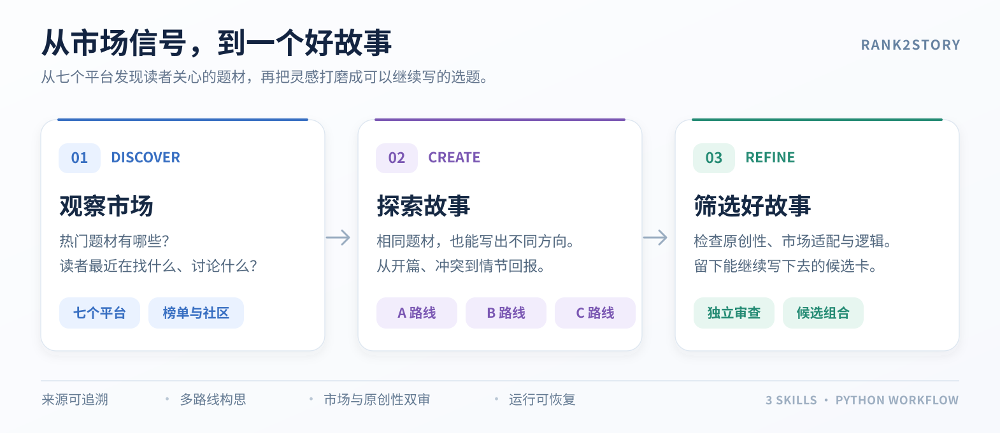

# Rank2Story

*Agent Skills for Chinese webnovel market research, ranking analysis, and evidence-driven story ideation.*

**让网文市场信息，成为有依据、能审阅的故事选题。**

[](pyproject.toml)
[](LICENSE)

Rank2Story 分别扫描**长篇与短篇**市场，将平台排行榜、读者讨论与社区推荐整理为可追溯的证据，再沿 A/B/C 多条故事路线完成构思、编辑、市场与原创性审查，形成结构化选题候选。

项目包含 **3 个可组合的 Agent Skills 和 Python 工作流**，既可独立从命令行运行，也可以接入支持 Skills 的工具，用于网文市场观察、创作选题与可复核的候选方案筛选。



## 核心能力

- **长篇与短篇分别扫榜**：针对不同篇幅使用不同的正式来源要求，结合站内榜单、阅读端排行、社区书单和视频讨论，观察题材趋势与读者需求。
- **证据驱动的故事设计**：校验来源和内容完整性，提取故事信号，沿 A/B/C 三条路线探索不同的核心冲突与情节机制。
- **独立评审与组合筛选**：故事编辑、市场适配、原创性审查、结构去重及 Pareto 筛选共同决定候选是否保留。
- **可恢复的执行流程**：为运行冻结输入与源码，支持状态查看、断点续跑及显式重跑，不用为了凑齐候选强制放宽审查。

## 快速开始｜通过 Agent 安装与使用

### 安装 Skills

将以下指令发送给 Agent，由 Agent 按安装文档完成项目接入与配置：

> 请阅读 https://raw.githubusercontent.com/Wlove2/rank2story/main/docs/INSTALL_FOR_AGENTS.md ，按照文档安装 Rank2Story 的三个 Skills、检查依赖，并协助配置候选生成使用的模型。完成后告知安装结果。

[Agent 安装文档](docs/INSTALL_FOR_AGENTS.md) · [首次运行准备与网站授权](docs/INSTALL_FOR_AGENTS.md#首次运行准备与网站授权) · [详细接入说明](docs/AGENT_INTEGRATION.md)

### 生成小说选题

候选任务通过**三个维度**确定作品定位：

| 维度 | 选项 | 作用 |
| --- | --- | --- |
| 篇幅 | 长篇 / 短篇 | 确定故事体量、叙事节奏和评审重点 |
| 目标平台 | 番茄 / 七猫 | 确定候选面向的平台内容环境和读者偏好 |
| 受众频道 | 男频 / 女频 | 确定核心读者群体和创作侧重点 |

例如，你可以选择不同的方向：

> 使用 Rank2Story，为**番茄 · 男频 · 长篇**生成一批小说选题。

> 使用 Rank2Story，为**七猫 · 男频 · 短篇**生成一批小说选题。

Agent 按照三个 Skills，优先查找对应篇幅的合格市场证据；需要时执行相应的长篇或短篇扫榜，再完成 A/B/C 多路线构思、编辑、独立审核与候选交付。

**三个维度指定的是创作目标，而不是市场信息的采集范围。** 项目结合多个小说平台、书单社区及视频讨论中的市场信号进行研究；当前候选定位支持番茄、七猫两个平台，其余来源用于跨平台参考。长短篇与男女频则进一步细化作品形式和目标读者。

已保存的**市场证据包**可以复用于多批候选任务；适用时可直接使用已有数据，不必每次重新扫榜。[查看数据包复用说明](docs/AGENT_INTEGRATION.md)。

### 配置模型

三个 Skills 共用候选生成流程的模型配置。在项目根目录的 `.env` 中填写模型 API 地址、模型名称及必要的 Key，也可使用 Agent 的安全凭据功能。[模型配置指南](docs/QUICKSTART.md) 提供字段说明与操作步骤。


**小红书图文识别与候选生成模型是两回事。** 有原生识图能力的 Agent 可直接逐张读取已下载的笔记图片，**不要求安装 Ollama**；缺少此能力时，才按需选用本地 Ollama 视觉模型。完整的依赖检查、图片读取与断点续采方式见 [安装与授权](docs/INSTALL_FOR_AGENTS.md) 和 [连接器说明](docs/CONNECTORS.md)。

## 市场数据来源与候选定位

Rank2Story 支持**长篇 / 短篇 × 番茄 / 七猫 × 男频 / 女频**三个创作定位维度。**市场扫描和候选定位是两回事**：采集不局限于目标创作平台，而是按长篇、短篇使用各自的市场来源，既看作品榜单，也看读者讨论。

项目保留了两次独立完成、通过正式验证的真实市场扫描：**10 月 9 日长篇**与**10 月 17 日短篇**。两次的来源数量、统计单位和采集日期各自独立，不能合并成同一次运行。

### 长篇市场｜2026 年 10 月 9 日

覆盖**七个平台、九类必需来源（9/9 通过）**，侧重男女频题材、新书、长线热度与读者反馈。

| 来源 | 真实采集内容 | 当次采集规模 |
| --- | --- | --- |
| **番茄小说** | 网页端男/女频新榜、阅读榜 | **74/74 分类、740 榜位** |
| **七猫小说** | 男/女频热门、新书、完结、收藏、更新 | **10 组榜单、200 榜位** |
| **起点中文网** | 月票、畅销、阅读指数、推荐、新书 | **5 组榜单、100 榜位** |
| **纵横中文网** | 月票、畅销、男女频新书、点击、推荐 | **6 组榜单、58 榜位** |
| **晋江文学城** | 季度积分榜 | **200 榜位** |
| **小红书** | 书荒、求推、书单与读者讨论 | **4 条完整合格笔记** |
| **Bilibili** | 书单、题材盘点、避雷与反馈 | **10 条完整合格视频** |

另外，番茄和七猫阅读端还保留了独立的分类榜与分页采集快照。公开展示了番茄 **74 类 × 每类前三本，共 222 条真实作品预览**，以及其他平台的榜单样本。

**[查看长篇七平台真实扫榜 →](docs/MULTIPLATFORM_SHOWCASE_20261009.md)**

### 短篇市场｜2026 年 10 月 17 日

短篇**不是沿用长篇榜单**，而是独立采集番茄作者端短篇热榜、番茄阅读端独立短篇榜、七猫短故事榜，以及两类社区读者信号。**五类必需来源全部通过（5/5）**，采集产物完整性和证据冻结均已验证。

| 来源 | 真实采集内容 | 纳入市场证据目录 |
| --- | --- | --- |
| **番茄作者端** | 综合、黑马涨幅、经典热门短篇热榜 | **22 部去重作品** |
| **番茄阅读端** | 独立短篇榜，两轮实时采集 | **60 部去重作品** |
| **七猫阅读端** | 短故事推荐榜、趋势榜 × 13 类，共 **26 榜、1,298 个榜位** | **608 部去重短故事** |
| **小红书** | 完整图文和逐图实际读取 | **5 条合格笔记** |
| **Bilibili** | 完整视频与读者信号 | **7 条合格视频** |

这轮独立短篇运行保留了 **702 条规范化市场证据**，分析抽样 **185 条作品或信号记录**。702 是当前运行去重后的证据目录条目，**不是原始榜位总数，也不是 702 个新生成的故事候选**。七猫 26 榜均已纳入证据目录。

**[查看 702 条完整短篇证据与作品样本 →](docs/SHORT_SCAN_SHOWCASE_20261017T144216Z.md)** · [另一轮 195 条历史展示](docs/SHORT_SCAN_SHOWCASE_20261017.md)

### 扫榜一次，可以复用多次生成

完成一次符合要求的市场扫描后，项目会得到一份**市场证据包**：它是有采集日期、来源记录和校验结果的固定版本数据，而不是一直自动更新的实时榜单。只要证据包的**篇幅范围与来源覆盖**满足新任务的要求，就可以复用它生成多批候选。

例如，长篇证据包可用于同方向的后续长篇候选，短篇证据包也可复用于后续短篇候选。**不同篇幅的证据包不能互相冒用**；每批候选都会创建独立任务进行构思、评审与校验。如果需要更新的趋势或不同的篇幅范围，再按需补采或重新扫榜。

重复使用不保证每批故事都不同，必要时还需做跨批去重；旧证据也必须保留原采集日期，不能当作当日最新榜单。详见 [复用数据与生成候选](docs/AGENT_INTEGRATION.md)。

## 故事候选：七批真实交付

Rank2Story 沿 A/B/C 多条路线，从市场线索出发构思故事，再经过故事编辑、市场适配与原创性评审、结构去重及候选组合筛选，产出可以继续完善的结构化选题卡。候选卡包含开篇、故事冲突、情节回报、结局方向及创作风险；长篇还包含分阶段的发展规划。

下表汇总 **2026 年 8—9 月七次真实候选任务**，合计 **29 张入选卡：长篇 6 张、短篇 23 张**。这些历史候选使用与各自篇幅匹配的市场证据包，**不是上面两次 10 月扫榜直接生成的结果**。仓库公开了 9 月 5 日一批的 **5 张完整候选卡及结构化 JSON**；其余六批只列出历史交付数量和故事方向摘要，未附逐张原始卡片及审核回执。

| 运行日期 | 目标定位 | 入选数量 |
| --- | --- | ---: |
| 9 月 5 日 | 七猫 · 男频 · 短篇 | 5 |
| 9 月 3 日 | 番茄 · 男频 · 长篇 | 3 |
| 8 月 4 日 | 番茄 · 男频 · 长篇 | 3 |
| 8 月 3 日 | 番茄 · 男频 · 短篇 | 4 |
| 8 月 2 日 | 番茄 · 男频 · 短篇 | 6 |
| 8 月 1 日 · 批次 B | 番茄 · 男频 · 短篇 | 4 |
| 8 月 1 日 · 批次 A | 番茄 · 男频 · 短篇 | 4 |
| **合计** | **七批独立任务** | **29** |

### 候选清单（按时间由近到远）

#### 9 月 5 日｜七猫 · 男频 · 短篇（5 张）

| 编号 | 故事方向 | 核心构思 |
| --- | --- | --- |
| `A-C02` | **隐藏身份的豪门赘婿** | 为报恩入赘并暗中反击家族恶徒，却背负着难以解释的旧伤与情感代价 |
| `B-C01` | **家族弃子假死反击** | 长期被家族安排顶罪的人借假死脱身，再用家族的秘密罪账发起反击 |
| `B-C03` | **妻子异变** | 丈夫怀疑妻子被怪物附身，后来发现她的异常举动可能是在向自己求救 |
| `C-C02` | **重生拒签合同** | 重生回关键签约现场的主角选择拒绝签字，试图改变家族和自己的命运 |
| `C-C03` | **重生后放弃家产** | 主角不再争夺继承权，转而利用前世经验从有限资源重新起步 |

#### 9 月 3 日｜番茄 · 男频 · 长篇（3 张）

| 编号 | 故事方向 | 核心构思 |
| --- | --- | --- |
| `A-C02` | **玉衡灯与庶子夺权** | 庶子以双重身份暗中经营，拼合祖传玉衡灯、夺回家主之位，却卷入器灵与旧都遗族的长线博弈 |
| `B-C01` | **燃血折寿的智斗阎罗** | 身负折寿代价的主角尽量不亲自动手，借布局制衡仇敌与权贵，同时寻找重铸命轮的方法 |
| `C-C02` | **重生汽修工守护小城** | 汽修工重生回 2019 年，将破修理铺一步步变成迎战魔潮的最后防线 |

#### 8 月 4 日｜番茄 · 男频 · 长篇（3 张）

| 编号 | 故事方向 | 核心构思 |
| --- | --- | --- |
| `A-C06` | **献祭成神，却逐渐失去情感** | 他人自愿献祭能为主角提供力量，但每次献祭都会让他永久失去一种情感 |
| `B-C04` | **道术编译系统** | 修士将天地法则拆解为可分析的代码，在末法时代尝试重新定义修炼和飞升规则 |
| `C-C02` | **仙术降维商业帝国** | 废灵根弃徒将仙术用于现代商业经营，逐步从宗门弃子走向两界规则的争夺者 |

#### 8 月 3 日｜番茄 · 男频 · 短篇（4 张）

| 编号 | 故事方向 | 核心构思 |
| --- | --- | --- |
| `A-C03` | **德链** | 隐藏身份的女主通过信用规则，使婆家的每次欺辱产生可见的信用后果 |
| `B-C03` | **双向伪装情侣** | 男女主各自隐藏真实身份，在感情与商业利益碰撞中揭露彼此的目的 |
| `C-C02` | **妖籍继承人** | 普通动物园饲养员牵出妖籍继承权与特殊血脉的秘密，后续又出现了修订卡 |
| `C-C03` | **直播告天** | 被天庭通缉的三流道士开直播曝光仙门黑料，试图用凡间舆论挑战神佛 |

#### 8 月 2 日｜番茄 · 男频 · 短篇（6 张）

| 编号 | 故事方向 | 核心构思 |
| --- | --- | --- |
| `A-C01` | **ICU 绝境反击** | 重病丈夫发现妻子和情人的谋财害命计划，尝试暗中取证逆转局面 |
| `A-C02` | **伪装恶人的丈夫** | 男主为保护妻子故意扮演恶人，最终与妻子联手对抗觊觎者 |
| `A-C03` | **公司规章反击** | 被陷害的职场人利用公司制度和证据，使施害者暴露自身问题 |
| `B-C01` | **揭发与反噬** | 丈夫揭发妻子不忠，却连带揭开自己年轻时不可告人的罪行 |
| `C-C01` | **信任值归零** | 在社会信任值会流失的都市体系中，工程师发现未婚妻是商业间谍 |
| `C-C02` | **祭祖记忆回溯** | 被家族轻视的养子利用限时记忆回溯能力，在祭祖仪式上揭开阴谋 |

#### 8 月 1 日 · 批次 B｜番茄 · 男频 · 短篇（4 张）

| 编号 | 故事方向 | 核心构思 |
| --- | --- | --- |
| `A-C02` | **全城屏幕曝光** | 丈夫掌握曝光出轨证据的技术权限，却考虑女儿的处境而选择有限反击 |
| `B-C03` | **救助挚友反成仇** | 男人拿出全部积蓄救下赌债缠身的朋友，却激发对方更扭曲的执念 |
| `B-C04` | **灰色软件偷走命运** | 父亲通过灰色软件夺取他人的机会，受害者多年后逆向调查揭露真相 |
| `C-C03` | **职场老好人的反击** | 长期被同事占便宜的人安排一次天价饭局，让欺压者面对自己过去的行为 |

#### 8 月 1 日 · 批次 A｜番茄 · 男频 · 短篇（4 张）

| 编号 | 故事方向 | 核心构思 |
| --- | --- | --- |
| `A-C01` | **家庭贡献评分** | 丈夫突然看见家人的贡献被实时评分，试图用同一套规则反击家庭不公 |
| `B-C02` | **让前妻后悔的代价** | 男人倾力追求功成名就，却发现前妻早已过上自己的生活 |
| `C-C02` | **ICU 内心字幕** | 瘫痪丈夫获得读取他人内心字幕的能力，发现骗保阴谋并设法从病床传出证据 |
| `C-C03` | **豪门饭局账单反击** | 财务职员利用账单与壳公司关系，在被迫买单的宴席上反击上司 |

### 真实候选卡与运行记录

**[查看 9 月 5 日一批的五张完整候选卡 →](docs/CANDIDATE_SHOWCASE_20260905.md)** · [查看对应的原始结构化 JSON](examples/showcase/verified_candidate_cards_20260905.json)

这一批面向**七猫男频短篇**，初步生成 9 个方向，经过自动评审后交付 5 张，保存了实际运行的完整卡片、开篇节拍、情节回报、结局与编辑风险。这批使用 `quality_strict` 策略；当前默认 `abc_branch_one` 已通过离线合成流程和规则测试，尚未随仓库公开同策略的完整真实模型交付记录。

**入选候选不是小说成稿，也不代表情节经过人工深度审稿。** 部分故事仍需核对人物动机、情节时间线与机制代价，详见完整卡的编辑风险。《德链》《妖籍继承人》《仙术降维商业帝国》等方向曾被继续写作和调整。这些案例展示的是实际形成的故事构思与筛选成果。

9 月 5 日该批任务累计 **36 次模型调用、约 43.8 万 Tokens**（输入约 33.3 万、输出约 10.5 万），只代表该批次的记录，不是全部七批的总成本。[查看该批模型调用与 Token 统计](docs/CANDIDATE_MODEL_AND_TOKENS.md)。

## 命令行体验（可选）

不使用 Agent 时，也可以从 Python CLI 运行。要求 **Python 3.11+**。可先运行完全离线的合成数据演示，了解从来源整理到候选筛选的工作流程：

```bash
git clone https://github.com/Wlove2/rank2story.git
cd rank2story
python -m pip install -r requirements.txt

# 离线工作流演示：不需要平台账号或模型 API
python examples/run_synthetic_scan_to_candidate.py

# 查看当前候选策略
python scripts/candidate.py config
```

上面的示例采用**合成数据**，不需要模型 API Key 或平台登录。真实使用需要自行接入有权限的来源和 OpenAI 兼容模型服务。**安装、配置 API Key、运行和查看结果的完整说明请见 [使用指南](docs/QUICKSTART.md)**。

### 候选策略

统一入口为 `scripts/candidate.py`，默认策略可在 `config/candidate.json` 中切换。

| 策略 | 定位 |
| --- | --- |
| **`abc_branch_one`（默认 · 4.4.2）** | A/B/C 路线优先保证结构差异，故事后每支至少保留 1 个可继续审查的候选；最终仍须通过独立评审与交付规则 |
| **`quality_strict`（质量严格策略）** | 在候选初筛阶段采用更高的存活数量要求，仍执行独立评审与交付校验 |

```bash
# 长篇示例：使用符合长篇要求的证据包初始化番茄男频候选
python scripts/candidate.py run --base-root ./data/runs --packet "<long-packet.json>" --lane long --platform fanqie --channel male

# 短篇示例：使用符合短篇要求的证据包初始化七猫男频候选
python scripts/candidate.py run --base-root ./data/runs --packet "<short-packet.json>" --lane short --platform qimao --channel male

# 可选：为新任务使用质量严格策略（此处以长篇为例）
python scripts/candidate.py run --policy quality_strict --base-root ./data/runs --packet "<long-packet.json>" --lane long --platform fanqie --channel male

# 后续操作使用创建运行时保存的版本
python scripts/candidate.py status --claim "<claim.json>"
python scripts/candidate.py verify --claim "<claim.json>"
```

以上两个数据包路径是示意写法，需要替换为**对应篇幅、已经通过来源验证的真实证据包**。命令只初始化候选任务，不会自动执行模型生成。运行状态、模型执行和恢复步骤见 [策略配置](docs/POLICY_CONFIGURATION.md) 与 [运行恢复](docs/CANDIDATE_RUN_RECOVERY.md)。

## 项目结构

```text
Rank2Story/
├── README.md                      # 项目说明
├── AGENTS.md                      # 支持此约定的 Agent 的工作区说明
├── .env.example                   # 模型配置模板；实际 .env 不进入 Git
├── LICENSE                        # MIT 许可证
├── requirements.txt               # Python 依赖
├── config/candidate.json          # 默认候选策略
├── scripts/
│   ├── candidate.py               # run / execute / status / verify 命令入口
│   ├── model.py                   # 项目模型配置状态及连通性检查
│   ├── model_config.py            # 安全加载本地 .env 配置
│   └── candidate_usage.py         # Token 用量统计
├── skills/
│   ├── novel-market-scan/         # 多平台市场扫描 Skill
│   ├── novel-candidate-portfolio/ # A/B/C 选题组合 Skill
│   └── novel-analyzer/            # 共享采集器、生成执行器及校验逻辑
├── variants/abc-branch-one/       # A/B/C 策略实现
├── examples/
│   ├── run_synthetic_scan_to_candidate.py  # 离线全流程演示
│   ├── check_model_endpoint.py             # 模型接口检查
│   ├── verify_source_manifest.py           # 文件完整性校验
│   ├── showcase/                           # 长篇、短篇真实扫榜与候选结构化样本
│   └── test_*.py                           # 回归测试
├── docs/
│   ├── QUICKSTART.md             # 使用指南与 API Key 设置
│   ├── AGENT_INTEGRATION.md      # Agent Skills 安装与使用
│   ├── INSTALL_FOR_AGENTS.md     # 交给 Agent 的安装指南
│   ├── CONNECTORS.md             # 平台访问与采集约束
│   ├── MODEL_CONNECTIVITY.md     # 模型连通性与排障
│   ├── POLICY_CONFIGURATION.md   # 策略配置
│   ├── RESULTS.md                # 长短篇市场成果与候选案例
│   ├── MULTIPLATFORM_SHOWCASE_20261009.md  # 长篇扫榜
│   └── SHORT_SCAN_SHOWCASE_20261017T144216Z.md     # 短篇扫榜
└── .github/workflows/            # CI 自动测试
```

## 使用指南与文档

通过 [Agent 安装指南](docs/INSTALL_FOR_AGENTS.md) 接入三个 Skills；[使用指南](docs/QUICKSTART.md) 包含模型配置、市场证据包复用及命令行操作。

[实际成果与案例](docs/RESULTS.md) · [长篇七平台扫榜](docs/MULTIPLATFORM_SHOWCASE_20261009.md) · [短篇五类来源扫榜](docs/SHORT_SCAN_SHOWCASE_20261017T144216Z.md) · [七批候选成果（29 张）](#故事候选七批真实交付) · [五张完整候选卡](docs/CANDIDATE_SHOWCASE_20260905.md) · [快速指南](docs/QUICKSTART.md) · [配置说明](docs/POLICY_CONFIGURATION.md) · [参与贡献](CONTRIBUTING.md) · [来源及版本说明](PROVENANCE.md)

**使用前请阅读：**[数据与隐私](docs/DATA_AND_RIGHTS.md) · [第三方许可](THIRD_PARTY.md) · [安全说明](SECURITY.md)。本项目不隶属于所涉及的网文及内容平台。

## License

**MIT** — [查看完整许可证](LICENSE)。本项目自有代码按 MIT 许可开源；第三方平台内容及外部适配器不自动受该许可覆盖，详见 [第三方许可与致谢](THIRD_PARTY.md)。
